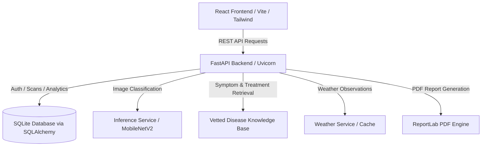

# PlantCare AI - Architecture & System Design

## 1. System Overview
**PlantCare AI** is an end-to-end intelligent agricultural diagnostic web application designed to empower farmers, extension agents, and agronomy students to identify crop diseases quickly and reliably from leaf imagery.

## 2. Layered Architecture

### A. Frontend Layer (Single Page Application)
- **Framework**: React 19 + Vite 6
- **Routing**: React Router DOM (Declarative client-side routing with protected route guards)
- **Styling**: Tailwind CSS with custom agricultural color palettes (forest green, emerald, earthy neutrals)
- **Charts & Visualizations**: Recharts for scan distribution, health breakdown, and temporal analytics
- **Icons**: Lucide React for consistent, accessible iconography
- **State & Data Fetching**: Centralized `api.js` client with JWT auto-refresh and auth state context

### B. Backend API Layer
- **Framework**: FastAPI (Asynchronous Python 3 Web Framework)
- **Data Validation & Schemas**: Pydantic v2 schemas for request and response validation
- **Authentication**: OAuth2 with JWT (JSON Web Tokens), bcrypt password hashing
- **Security**: Strict CORS headers, upload file type validation (content inspection, not just extension), file size boundaries, path traversal guards
- **Documentation**: Automatic OpenAPI / Swagger UI at `/docs` and ReDoc at `/redoc`

### C. Database Layer
- **ORM**: SQLAlchemy 2.0 with declarative models
- **Database Engine**: SQLite for local zero-configuration persistence
- **Schema Migrations**: Alembic
- **Models**:
  - `User`: Account credentials, profile details, created timestamp
  - `DiagnosisScan`: Image path, detected disease class, confidence score, reliability status, user association, timestamp
  - `DiseaseRecord`: Structured crop disease catalog (symptoms, causes, management)
  - `ChatHistory`: Contextual conversation logs for the agricultural assistant

### D. Machine Learning & Inference Pipeline
- **Backbone**: MobileNetV2 pretrained on ImageNet, fine-tuned on the PlantVillage tomato disease subset
- **Preprocessing**: Exact MobileNetV2 normalization (`[-1, 1]`), bilinear resize to 224x224
- **Inference Engine**: TensorFlow/Keras pipeline with threshold-based reliability detection (identifies out-of-distribution or uncertain leaf imagery)
- **Output Schema**: Predicted class, display name, confidence score, top alternative candidates, uncertainty flags

### E. Weather & Advisory Subsystem
- **Provider**: OpenWeatherMap API (or configurable fallback provider)
- **Caching**: In-memory / time-to-live caching to prevent rate-limiting and latency
- **Agronomic Correlation**: Temperature and relative humidity indicators paired with disease development thresholds (e.g., Late Blight thrives at 15–21°C with >90% humidity)

### F. PDF Report Engine
- **Library**: ReportLab
- **Output**: Clean, printable diagnostic summaries including scan metadata, confidence score, symptom profiles, and management guidelines
